<!-- easy-suite:header:start -->
<p align="center">
  <a href="#easy-suite">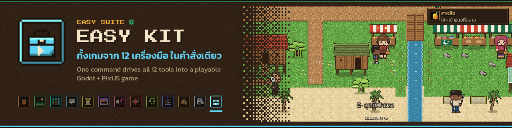</a>
</p>

<p align="center">
  <b>Easy Kit</b> · ทั้งเกมจาก 12 เครื่องมือ ในคำสั่งเดียว · One command drives all 12 tools into a playable Godot + PixiJS game<br />
  <sub>Part of <a href="#easy-suite"><b>Easy Suite</b></a>: Thai-friendly pixel-art game dev tools for Godot 4.3+ and PixiJS v8</sub>
</p>

<p align="center">
  <a href="https://github.com/Saladin2020/easykit/actions/workflows/ci.yml"></a> <a href="LICENSE"></a>   <a href="docs/MCP.md"></a> 
</p>

<p align="center">
  <a href="https://github.com/Saladin2020/easysprite"></a>
  <a href="https://github.com/Saladin2020/easyscene"></a>
  <a href="https://github.com/Saladin2020/easytilemap"></a>
  <a href="https://github.com/Saladin2020/easydialogue"></a>
  <a href="https://github.com/Saladin2020/easyquest"></a>
  <a href="https://github.com/Saladin2020/easyui"></a>
  <a href="https://github.com/Saladin2020/easysfx"></a>
  <a href="https://github.com/Saladin2020/easyfx"></a>
  <a href="https://github.com/Saladin2020/easymusic"></a>
  <a href="https://github.com/Saladin2020/easyanim"></a>
  <a href="https://github.com/Saladin2020/easyitems"></a>
  <a href="https://github.com/Saladin2020/easysave"></a>
  <a href="https://github.com/Saladin2020/easykit"></a>
  <a href="https://github.com/Saladin2020/easybattle"></a>
  <a href="https://github.com/Saladin2020/easyfont"></a>
  <a href="https://github.com/Saladin2020/easynpc"></a>
  <a href="https://github.com/Saladin2020/easyportrait"></a>
  <a href="https://github.com/Saladin2020/easyship"></a>
</p>
<!-- easy-suite:header:end -->

# Easy Kit

**คำสั่งเดียว สร้างเกมที่เล่นได้จริงจากเครื่องมือ Easy: เดินในหมู่บ้าน คุยกับ NPC (มีภาพหน้าตัวละครกะพริบตา-ขยับปาก) ชาวบ้านใช้ชีวิตตามตารางเวลา มีนาฬิกาและกลางคืน ทำเควสต์ ซื้อของ สู้กับสัตว์ในทุ่งนา ดูคัตซีน มีเพลง เอฟเฟกต์ ฟอนต์พิกเซลไทย "มะขาม" เซฟเกม และสลับภาษา ไทย · English · Melayu แล้วแพ็กออกเป็นไฟล์พร้อมปล่อยด้วย Easy Ship**  
`easykit new VillageDemo --template village_delivery` drives Easy Sprite, Portrait, Scene, Tilemap, Dialogue, NPC,
Quest, Font, UI, SFX, FX, Music, Anim, Items, Battle and Save through their own CLIs and MCP servers, then assembles
the exports into a **Godot 4.3+** project (with a passing headless test) and a **PixiJS v8** web build of the same
game. `easykit ship` hands both builds to **Easy Ship** (plan by default, `--build` for local zips; never uploads).
The 12 core tools are required; Portrait, NPC, Font, Battle and Ship are optional and the game is built without their
parts when they are not installed. A unified MCP server proxies all 17 tools under namespaced names
(`sprite__export_character`, `save__check_all`, …) next to the kit's own `new_project`, `ship_plan`, `doctor` and
`status`. CLI, web dashboard, MCP over stdio and HTTP; local only.

<p align="center">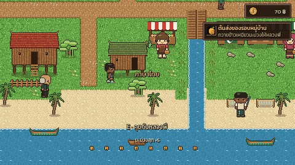</p>

| Godot 4.3 (gl_compatibility) | Thai dialogue (Easy Dialogue box) |
|---|---|
| 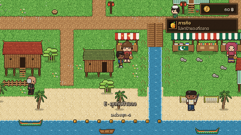 | 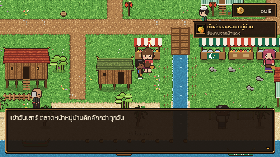 |
| **Pixi web build: title (Easy Scene backdrop)** | **Pixi web build: Bang Roti's halal stall (Easy Items)** |
| 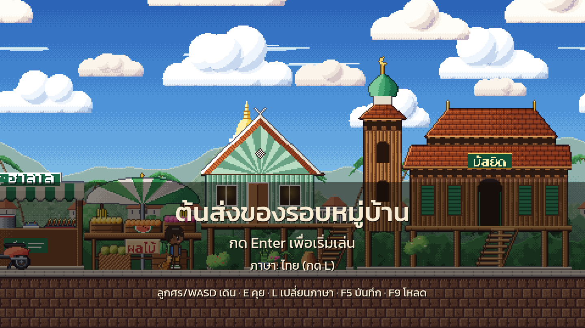 | 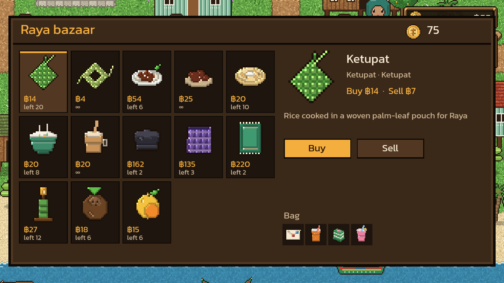 |
| **Easy Battle: paddy-field encounter (Godot)** | **Easy NPC: the village at 20:30 (Godot)** |
| 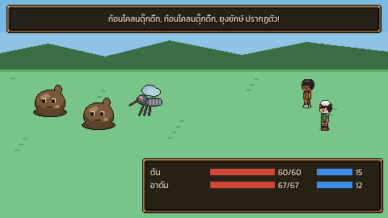 | 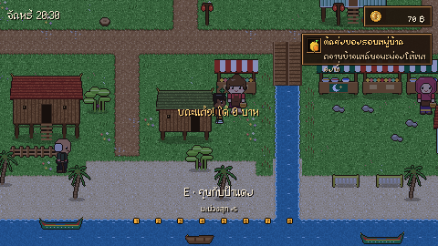 |
| **Easy Portrait over the Easy Dialogue box (web)** | **มะขาม pixel font in the HUD and dialogue (Godot)** |
| 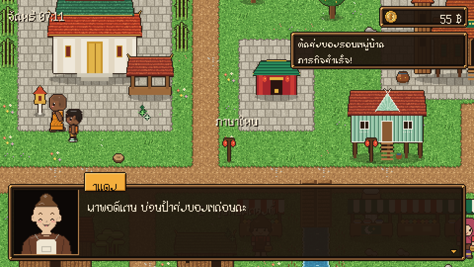 | 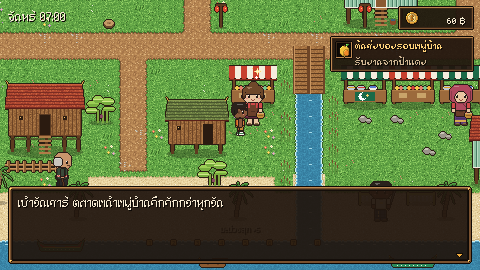 |

## Quick start

```bash
# the Easy repos side by side (or set EASY<TOOL>_HOME / easykit.config.json), each with npm ci && npm run build
npm ci && npm run build
node dist/cli.js doctor                      # which tools are installed, versions, Godot / Chrome / xvfb
node dist/cli.js new VillageDemo --template village_delivery --seed 7 --dir ~/games
node dist/cli.js check ~/games/VillageDemo --shots ~/games/shots --frames
godot --path ~/games/VillageDemo/godot       # or serve ~/games/VillageDemo/web
node dist/cli.js ship ~/games/VillageDemo     # Easy Ship release plan; --build zips web builds locally
```

About 50 s on a laptop with all 17 tools (30 s with the 12 core ones). `--engine godot|pixi|both` (default both), `--seed N` varies the player's shirt colour, the
coin sound, the coin-burst particles and the village theme, `--force` replaces an existing folder.

## What `easykit new` does

| # | Tool | What it makes for the game | How Easy Kit calls it |
|:-:|---|---|---|
| 1 | Easy Sprite | 8 top-down + 4 side-view sheets for the cast; the player's shirt is recoloured from the seed | MCP `export_character` (a kit-owned workspace in `.easy/sprite`) |
| 1b | Easy Portrait *(optional)* | Dialogue portraits of ต้น, ป้าแดง, ลุงมี and ตาเพิ่ม made from the generated sheets, with blink + talk strips; they replace Easy Dialogue's sample portraits | CLI `from-sprite --th --en --ms`, `export --preset dialogue\|godot\|pixi` |
| 2 | Easy Scene | Title backdrop: `harmony_town` rendered with the player's side-view sheet | CLI `render --mode viewport --character` |
| 3 | Easy Tilemap | `multicultural_village` map; NPCs swapped for the generated sheets, a farmer added by the paddy | CLI `character …`, `export --target godot,pixi` |
| 4 | Easy Dialogue | `village_delivery` story, split per NPC and localised to th / en / ms | CLI `compile`, `export` |
| 4b | Easy NPC *(optional)* | Daily schedules for 5 villagers (Kak Fatimah, Adam, Pak Cik Ismail, Aisyah, Pak Hamid) on the same map, a day clock with night; quest NPCs stay put | CLI `init`, `export --preset godot\|pixi` |
| 5 | Easy Quest | Delivery quest (accept → temple → farm → bonus mango → elder → report) + `QuestManager` | CLI `export` |
| 5b | Easy Font *(optional)* | มะขาม 16 / 8 Thai · Latin · Malay pixel fonts for the HUD and the dialogue box (มะขาม 12 for projects made before the switch); dialogue text is shaped at build time and the box is checked to fit the 22 px line | CLI `init`, `check`, `export` |
| 6 | Easy UI | Teak theme, HUD (wallet, quest panel), fonts | CLI `export` |
| 7 | Easy SFX | Sound bank with a seeded coin sound, typing blips | CLI `add coin --seed`, `export` |
| 8 | Easy FX | 8 effects incl. a seeded coin burst (coin, level-up, sparkle, confetti, dust, heal, fireflies, lanterns) | CLI `new --from --set seed=`, `export` |
| 9 | Easy Music | `village_day` (seeded) for the world, `shop_theme` for the stall | CLI `new --from --set seed=`, `export` |
| 10 | Easy Anim | Intro cutscene `village_morning_delivery` acted by the generated side-view sheets | CLI `export` |
| 11 | Easy Items | Items database, wallet, inventory, `raya_bazaar` shop UI | CLI `export` |
| 11b | Easy Battle *(optional)* | Paddy-field encounters (`plains_fields`), party ต้น + Adam at level 3, ต้น drawn from the generated side-view sheet | CLI `init`, `check`, `export --preset godot\|pixi` |
| 12 | Easy Save | Save schema v3 + string tables re-extracted from this project's dialogue / quest / UI / items, plus the kit's 35 keys | CLI `extract`, `export --preset all` |
| — | Easy Kit | Merges every Godot export into `godot/` (autoloads, translations, `kit/main.tscn` glue) and every web export into `web/` | — |
| ⇢ | Easy Ship *(optional)* | `easykit ship`: release configs for `godot/` and `web/`, a plan, or `--build` zips in `.easy/ship/releases/` | CLI `new`, `plan`, `ship --build` (never `--upload`) |

Each tool works in `<project>/.easy/<tool>` with `EASY<TOOL>_WORKSPACE` and `EASY<TOOL>_ALLOWED_DIRS` set to the
project, so the sibling repos are never written to. Sprite sheets and every other generated asset stay in the
project; nothing generated is committed to this repo.

## The village_delivery game

ต้นส่งของรอบหมู่บ้าน · *Ton's village deliveries* · *Penghantaran Ton di kampung*. A top-down multicultural southern
Thai village (Buddhist temple, wooden kampung mosque, market, paddy, river) at 480×270:

- **Walk**: arrows / WASD; the camera follows Ton, buildings and NPCs collide.
- **Talk**: E or Enter near an NPC. Auntie Daeng (market) gives the job; Luang Phi (temple), Lung Mee (farm) and
  Grandpa Phoem (elder) each play their own dialogue segment; others answer with short barks in the current language.
- **Quest**: step and completion toasts with Easy FX, quest panel in the Easy UI HUD, coins into the Easy Items wallet.
- **Shop**: Bang Roti's halal stall (Easy Items `raya_bazaar`), its own Easy Music theme.
- **Cutscene**: intro from Easy Anim (Esc skips), with dialogue lines and music cues.
- **Save**: F5 quick save / F9 quick load (Easy Save slots with checksum + `.bak`), autosave every 2 minutes (Easy Save rotation); F9 on the
  title continues.
- **Languages**: L cycles th → en → ms for the HUD, prompts, barks and dialogue (Easy Save translations / Godot
  `TranslationServer`).

With the optional tools installed:

- **Portraits** (Easy Portrait): the speaker's portrait blinks and moves its mouth while a line types.
- **Villagers** (Easy NPC): five villagers walk their daily schedules (stall, mosque, home, paddy); the HUD shows the
  weekday and time, nights tint the village, barks name what the villager is doing and raise their friendship.
- **Pixel font** (Easy Font): HUD labels, prompts, toasts and the dialogue box use มะขาม 16 (22 px lines; the dialogue box grows upward to hold 3 lines and the build fails if it cannot fit), small labels use มะขาม 8; the big title stays in Kanit. The game renders at 480×270 and is shown at 2× or larger. Projects made before มะขาม 16 keep มะขาม 12 until you run `easykit build <project> --font makham-16`.
- **Battles** (Easy Battle): walking the paddy (tiles 37–42 × 1–6) triggers encounters, the first one scripted; win
  coins go into the wallet, a loss heals the party. Uncle Mee's spot beside the paddy stays outside the encounter zone.
- Battle party, villager clock and friendship are saved with F5 (Easy Save `items.npc` / `items.battle`).

The Godot test (`kit/test_game.gd`, 73 checks with all tools) and the web check (`scripts/check-web.py`, 34 checks in
headless Chrome) play the whole quest, the shop, save/load, the language switch, the portraits, the schedules, the
pixel font and a battle.

## Project layout

```
VillageDemo/
  easykit.project.json   manifest: seed, tool versions + commits, every step's outputs and notes
  README.md              how to run it and what each tool made
  assets/                generated character sheets (never shipped by Easy Kit)
  .easy/<tool>/          each tool's workspace: edit with the tool, then `easykit build VillageDemo`
  godot/                 Godot 4.3+ project (open project.godot)
  web/                   PixiJS v8 build (index.html, pixi.min.js bundled)
```

## CLI

`easy` and `easykit` are the same binary.

| Command | |
|---|---|
| `easykit new <Name> [--template village_delivery] [--engine godot\|pixi\|both] [--seed N] [--dir D] [--force] [--json]` | Scaffold a game with the 12 core tools + the optional ones installed |
| `easy init [dir] [--from <project>] [--name N] [--force]` | Write `game.easy.json` for a new game, or describing an existing Easy Kit project |
| `easy validate [project] [--no-prepare] [--json]` | Schema + every cross-reference (quest items, NPC portraits, battle enemies, dialogue speakers, halal stalls…), errors in Thai and English |
| `easy build [project] [--engine …] [--force] [--only items,save] [--ship] [--json]` | With `game.easy.json`: run every tool in dependency order, skip unchanged steps, assemble Godot / Pixi, write `BUILD-REPORT.md` ([docs/GAME-MANIFEST.md](docs/GAME-MANIFEST.md)). Without it: re-assemble `godot/` and `web/` from `.easy/` (`--font makham-16` opts in to another font) |
| `easykit check <project> [--no-godot] [--no-web] [--shots DIR] [--frames]` | Godot import (retried once if the first headless pass flakes; under xvfb + opengl3) + headless test, web check in headless Chrome, screenshots / GIF frames |
| `easykit doctor [--json]` | Installed tools, versions, git commit, build state; Godot, Chrome, xvfb |
| `easykit status [path]` | One project or every project in a folder |
| `easykit ship <project> [--build] [--targets web,linux,windows,android] [--release V] [--itch user/game] [--json]` | Easy Ship release configs + plan; `--build` builds and zips locally. Never uploads (run `easyship ship <id> --upload` yourself) |
| `easykit tools` | The 17 tools, roles and ports |
| `easy studio [projectsDir] [--port 8908] [--open]` | **Easy Studio**: local web UI over `game.easy.json` — project list, schema-generated form + raw JSON, live Thai/English validation with jump-to-field, streamed build log, Pixi preview + check screenshots, open in Godot / Aseprite, ship locally. Always binds 127.0.0.1 ([docs/STUDIO.md](docs/STUDIO.md)) |
| `easykit serve [--port 8908] [--projects DIR] [--dev]` | Dashboard: doctor table, new-project form, project list, play the web build (below) |
| `easykit mcp [--http] [--port 8909] [--workspace DIR] [--project DIR]` | Unified MCP server |

`python3 scripts/make-gif.py SHOTS/godot out.gif` turns `--frames` output into a GIF.

<p align="center">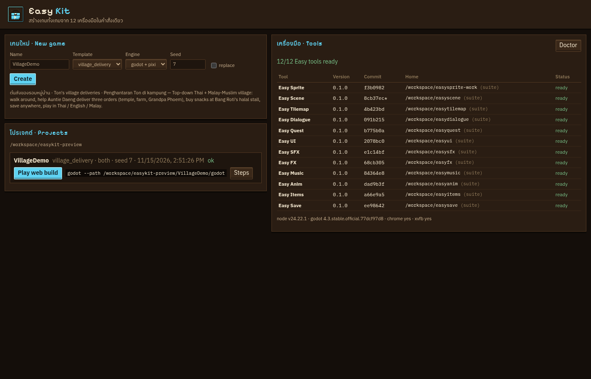</p>

## MCP

`easykit mcp` (stdio) or `easykit mcp --http` (`http://127.0.0.1:8909/mcp`) exposes the kit tools `new_project`,
`build_project`, `check_project`, `ship_plan` (plan only), `doctor`, `status`, `list_tools` and proxies every installed
tool as `<tool>__<name>` across the 17 servers. Sibling servers start lazily on first
use. `EASYKIT_MCP_TOOLS=save,fx` limits the proxy, `none` turns it off. See [docs/MCP.md](docs/MCP.md).

```json
{ "mcpServers": { "easykit": { "command": "node", "args": ["/path/to/easykit/dist/cli.js", "mcp", "--workspace", "/path/to/games"] } } }
```

## Configuration

Tool lookup, first match wins: `EASY<TOOL>_HOME` (e.g. `EASYSAVE_HOME`) → `tools.<id>` in `easykit.config.json`
(`$EASYKIT_CONFIG`, `./easykit.config.json`, then the kit folder) → `<suiteDir>/easy<id>` (default: the folder
holding Easy Kit; Easy Sprite also tries `easysprite-work`). A folder only counts if its `package.json` name matches.
Copy [easykit.config.example.json](easykit.config.example.json). Godot: `EASYKIT_GODOT`, `GODOT_BIN`, `GODOT`, `godot` in the
config, `godot4` / `godot` on `PATH`, then the usual installs (Windows Chocolatey `C:\ProgramData\chocolatey\bin\godot.exe`);
Aseprite (Studio only): `ASEPRITE_BIN`, `aseprite` in the config, `PATH`, then Steam / standard installs; Chrome: `EASYKIT_CHROME`,
`chrome` in the config or the usual install paths; Python for the web check: `EASYKIT_PYTHON` (default `python3`, `python` on Windows).

Ports (unique across the suite): dashboard **8908**, MCP HTTP **8909**, Vite **5187**, web check server 8989.
Non-loopback hosts need the token printed at start (`EASYKIT_TOKEN` to set one).

## Development

```bash
npm ci
npm run typecheck && npm run build && npm test   # 43 tests; integration tests skip without the sibling repos
npm run smoke                                    # MCP (stdio + HTTP) and CLI smoke; `new` / `ship` only when doctor is ok
npm run dev                                      # API on 8908 + `npx vite --config web/vite.config.ts` on 5187
```

CI has no sibling repos: integration tests, the proxied-MCP test and `easykit new` in the smoke test skip
themselves (doctor reports 0/17). Locally with the whole suite they run the full pipeline. `EASYKIT_SKIP_INTEGRATION=1`
forces the skip.

## Limitations

- One template so far (`village_delivery`); it reuses the Easy Tilemap sample map and the Easy Dialogue / Quest / Anim
  samples, re-cast with generated characters, rather than generating a new map or story.
- The intro cutscene's lines exist in Thai and English only (Easy Anim sample); Malay falls back to English there.
- Two files are exported by more than one tool (`background.png`, `dialogue/village_delivery.dialogue.json`); the
  first writer wins and the build lists the collisions.
- Refusing Auntie Daeng keeps the quest available (the kit never emits the quest's `fail` event).
- The Easy Items shop UI is laid out for 640×360 and is scaled to 75 % in the 480×270 game.
- Only the five bark villagers follow Easy NPC schedules; the quest NPCs keep their spots so the quest stays reachable.
- The Pixi build rolls random encounters with `Math.random` (Godot uses the Easy Battle autoload's RNG); the first
  battle is the same scripted one in both.
- Easy Ship web builds of the Pixi game need `pixi.min.js` in `web/` (Easy Kit bundles it); desktop / Android targets
  need Godot export templates (and the Android SDK) — see `easyship doctor`.

<!-- easy-suite:table:start -->
## Easy Suite


Eighteen small, local-first tools that share one look (teak, lantern gold, Kanit, 16/48px pixels), one
workflow (CLI · web editor · MCP server) and the same targets (**Godot 4.3+** and **PixiJS v8**).
ชุดเครื่องมือทำเกมพิกเซลสไตล์ไทย ใช้ร่วมกันได้ทั้งชุด · **Easy Kit** builds a whole playable game from the others and
**Easy Ship** packages it for the web, desktop and Android.  
The samples share one multicultural southern Thai village: Buddhist temple, wooden kampung mosque and
Chinese-Thai shrine on the same street. หมู่บ้านพหุวัฒนธรรม วัด มัสยิด ศาลเจ้า อยู่ร่วมกันในเมืองเดียว

| | Tool | What it does | Repo |
|:-:|---|---|---|
|  | [**Easy Sprite**](https://github.com/Saladin2020/easysprite) | Compose modular 48px chibi characters (top-down + side-view) and export sheets. | [`easysprite`](https://github.com/Saladin2020/easysprite) |
|  | [**Easy Scene**](https://github.com/Saladin2020/easyscene) | Side-view levels: parallax layers, 16px autotiles, Thai town props. | [`easyscene`](https://github.com/Saladin2020/easyscene) |
|  | [**Easy Tilemap**](https://github.com/Saladin2020/easytilemap) | Top-down 16px maps: blob-47 autotiles, objects, collision, spawns. | [`easytilemap`](https://github.com/Saladin2020/easytilemap) |
|  | [**Easy Dialogue**](https://github.com/Saladin2020/easydialogue) | Branching `.ezd` dialogue with Thai-safe text, portraits and choices. | [`easydialogue`](https://github.com/Saladin2020/easydialogue) |
|  | [**Easy Quest**](https://github.com/Saladin2020/easyquest) | Text `.ezq` quests: steps, flags, items, rewards, linked to dialogue. | [`easyquest`](https://github.com/Saladin2020/easyquest) |
|  | [**Easy UI**](https://github.com/Saladin2020/easyui) | Nine-slice pixel UI kit: panels, bars, inventory, menus, 30 icons. | [`easyui`](https://github.com/Saladin2020/easyui) |
|  | [**Easy SFX**](https://github.com/Saladin2020/easysfx) | Deterministic 8-bit SFX and 4-channel chiptune loops, typing blips. | [`easysfx`](https://github.com/Saladin2020/easysfx) |
|  | [**Easy FX**](https://github.com/Saladin2020/easyfx) | Pixel particles: sparks, fire, rain, lanterns, Raya pelita; sheets + Godot particles. | [`easyfx`](https://github.com/Saladin2020/easyfx) |
|  | [**Easy Music**](https://github.com/Saladin2020/easymusic) | Seeded Thai loop music: ranat, khong wong, saw, khim, pi, kompang; seamless WAV/OGG loops. | [`easymusic`](https://github.com/Saladin2020/easymusic) |
|  | [**Easy Anim**](https://github.com/Saladin2020/easyanim) | Cutscene timelines: actors, camera, dialogue, FX and music cues; Godot + Pixi runners. | [`easyanim`](https://github.com/Saladin2020/easyanim) |
|  | [**Easy Items**](https://github.com/Saladin2020/easyitems) | Item database, shops, inventory, loot tables and crafting; 44 starter items with pixel icons. | [`easyitems`](https://github.com/Saladin2020/easyitems) |
|  | [**Easy Save**](https://github.com/Saladin2020/easysave) | Versioned save slots with migrations and checksums; Thai / English / Malay string tables. | [`easysave`](https://github.com/Saladin2020/easysave) |
|  | **Easy Kit** ← you are here | One command drives the Easy tools into a playable Godot 4.3+ and PixiJS game (portraits, schedules, battles, Thai pixel font) and ships it with Easy Ship; unified MCP server and `doctor`. | [`easykit`](https://github.com/Saladin2020/easykit) |
|  | [**Easy Battle**](https://github.com/Saladin2020/easybattle) | Turn-based battles: party, bestiary, skills, statuses, bosses; seeded simulator; Godot + Pixi runtimes. | [`easybattle`](https://github.com/Saladin2020/easybattle) |
|  | [**Easy Font**](https://github.com/Saladin2020/easyfont) | Pixel bitmap fonts for Thai, Latin and Malay: stacking vowels and tones, BMFont / TTF for Godot + Pixi. | [`easyfont`](https://github.com/Saladin2020/easyfont) |
|  | [**Easy NPC**](https://github.com/Saladin2020/easynpc) | NPC daily schedules with A* on Easy Tilemap maps, day / night, affinity, dialogue and quest hooks. | [`easynpc`](https://github.com/Saladin2020/easynpc) |
|  | [**Easy Portrait**](https://github.com/Saladin2020/easyportrait) | 64×64 dialogue portraits with 9 emotions, blink and talk frames, from Easy Sprite characters. | [`easyportrait`](https://github.com/Saladin2020/easyportrait) |
|  | [**Easy Ship**](https://github.com/Saladin2020/easyship) | Toolchain doctor, web / Windows / Linux / Android builds, itch.io zips and butler plans; dry run by default. | [`easyship`](https://github.com/Saladin2020/easyship) |

### Works with

All seventeen: Easy Kit runs each tool's own CLI (Easy Sprite through its MCP server), so a tool upgrade reaches new
projects without kit changes. `easykit doctor` shows which commit of each tool built a project, and the manifest
records it.
<!-- easy-suite:table:end -->

## Credits

Code: MIT. The template's kit strings and glue are written for this repo (CC0 1.0). Everything a generated game
contains comes from the Easy tools under their own terms (samples CC0, Kanit SIL OFL 1.1); PixiJS v8 (MIT) is
copied into web builds. See [CREDITS.md](CREDITS.md).
