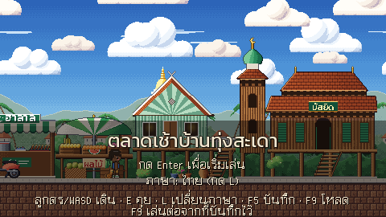
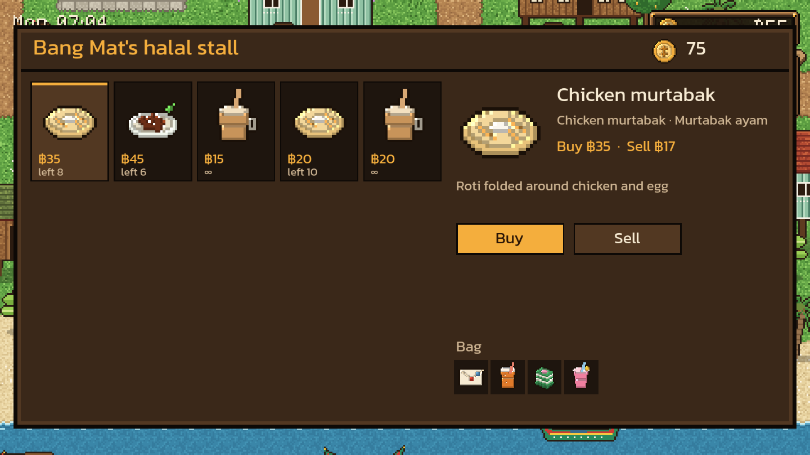

# game.easy.json + `easy build`

One file describes the whole game; `easy build` drives all 17 Easy tools (+ Easy Kit = 18) to make it.

```sh
easy init --from projects/MyVillage      # describe an existing Easy Kit project
easy init MyGame                         # or start from the village_delivery base
easy validate MyGame                     # schema + cross-references, Thai + English messages
easy build MyGame                        # incremental; BUILD-REPORT.md + .easy/build-report.json
easy build MyGame --ship                 # + Easy Ship local packages (never uploads)
easykit check MyGame --shots shots/      # headless Godot + web tests
```

Example: [`examples/tung_sadao`](../examples/tung_sadao) — ตลาดเช้าบ้านทุ่งสะเดา, a Thai village with a halal roti stall (Easy Items `halal: true`, checked by `items.halalShops`) and an ATB battle over a custom encounter table.

<p align="center"> </p>

## Shape

Schema: [`schema/game.easy.schema.json`](../schema/game.easy.schema.json) (generated from `src/lib/manifest.ts` with `npm run schema`; TS types `GameManifest` / `GameManifestInput`).

| Section | Tool | Says |
|---|---|---|
| `game` | — | `name`, `title{th,en,ms}`, `setting{th,en}` (Thai script required), `engine` godot\|pixi\|both, `font` (default `makham-16`), `seed`, `viewport`, `base` (kit glue), `locales` |
| `sprites` | Easy Sprite | `player`, `palette`, `cast[]` / `side[]` (`id`, `base` project, `recolor`, `map` name, `at`, `facing`) |
| `portraits` | Easy Portrait | `sets[]` made `from` cast members, `keep` sample ids |
| `scenes` | Easy Scene | `title{id, cameraRange, actor}` |
| `tilemaps` | Easy Tilemap | `main` map |
| `npcs` | Easy NPC | `roles` (quest/shop/bark per map character), `schedules` (map character → Easy NPC id), `start`, `secondsPerMinute` |
| `dialogue` | Easy Dialogue | `main`, `style`, `segments` |
| `quests` | Easy Quest | `main` file, `quest` id |
| `items` | Easy Items | `shop`, `halalShops` |
| `battle` | Easy Battle | `table`, `enemies`, `zone`, `party`, `heroSheets`, `timing` turn\|atb, `atbMode`, `layout` classic\|backview, `status` |
| `ui` / `fx` / `sfx` / `music` | Easy UI / FX / SFX / Music | screen + theme; seeded variations + exports; world / shop songs |
| `anim` | Easy Anim | `cutscene` |
| `save` | Easy Save | `schema` (th/en/ms string tables are extracted from the other docs) |
| `ship` | Easy Ship | `targets`, `release`, `itch`, `androidPackage` |

Every section except `game` and `ship` takes `sources`: project files (a `*` is allowed in the file name) copied into that tool's workspace before its step, e.g. `"sources": ["content/items/*.easyitems.json"]`.

## Validation

`easy validate` creates missing tool workspaces, copies sources in, then checks ids against what the tools hold: sprite bases, portrait sets ⊂ cast, scene + actor, map characters, dialogue + `@char` portraits, NPC ids / sheets / portraits, quest file + give/take/reward items ∈ Easy Items, quest givers ∈ dialogue speakers, shops, halal stalls (`halal: true`, nothing tagged pork / alcohol / non_halal), battle table / enemies / heroes / hero sheets, UI screen, FX / SFX / music presets, cutscene, save schema, font, Android package. Content rules: Thai names in Thai script; no Quran, Arabic calligraphy, adhan or prophets as game content.

```
✗ [battle.enemies[4]] ไม่พบศัตรู "dragon" ใน Easy Battle (มี / have: cave_bat, cobra, …)
    Battle enemy "dragon" not found in Easy Battle (มี / have: cave_bat, cobra, …)
```

## Build

Order (stable topological sort, ties in pipeline order): sprite → portrait → scene → tilemap → dialogue → npc → quest → font → ui → sfx → fx → music → anim → items → battle → save → Godot → Pixi. Each step reuses Easy Kit's existing step (the tool's CLI / MCP).

A step is skipped when its hash — the manifest parts it reads, seed, tool version + git commit + dirty flag, kit version, upstream results — matches `.easy/build-state.json`, its workspace is unchanged since it last ran (so editing a tool document or a source rebuilds it and its dependants) and its outputs exist. `--force` rebuilds everything, `--only` limits to some tools. The build also writes `easykit.project.json`, so `easykit check / ship / status` and the dashboard work unchanged.
