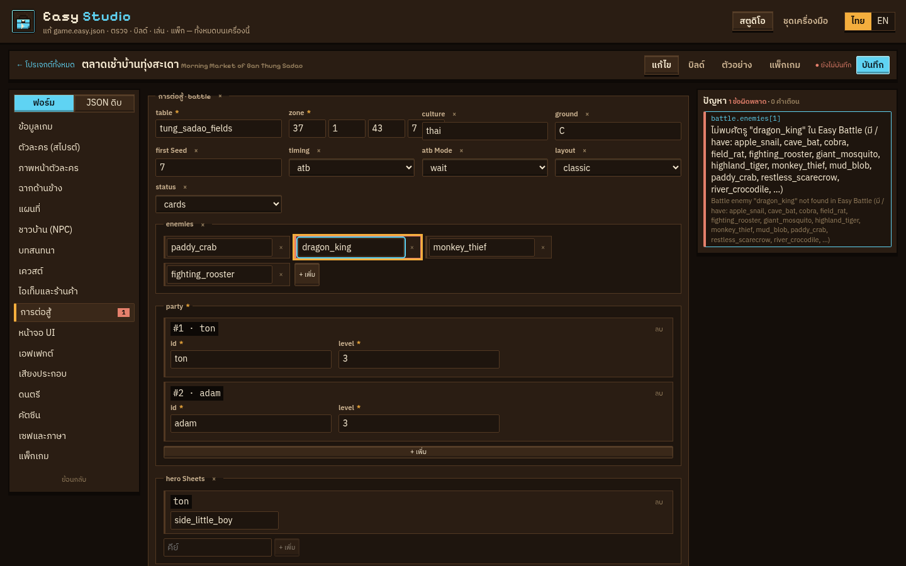

# Easy Studio

A local web UI for a game described by `game.easy.json` ([GAME-MANIFEST.md](GAME-MANIFEST.md)). It is the Easy Kit
dashboard (same server, port **8908**) with a Studio front page; the old dashboard lives under **Kit & tools**.

```bash
easy studio                    # projects = current folder
easy studio D:\games --open    # Windows; --open launches the default browser
easy studio ./MyGame           # a single project folder: its parent is listed
```

`easy studio` always binds **127.0.0.1** (the Host-header / Origin guard of the dashboard applies). Nothing is
uploaded anywhere: Ship runs Easy Ship in local build mode (`.easy/ship/releases/`).

<p align="center"></p>

## Screens

| Screen | What it does |
|---|---|
| Projects | Every folder with `game.easy.json` (or a legacy `easykit.project.json`, with **Create game.easy.json** = `easy init --from`). Last build status and the latest check screenshot as thumbnail. **New game** writes a manifest from a template (build it from the Build tab). |
| Edit | A form generated from `schema/game.easy.schema.json` (objects, records, arrays, tuples, enums), one section at a time, plus a **Raw JSON** tab. Every edit is validated live against the *unsaved* draft (`easy validate` with sources copied): errors / warnings in Thai or English with the other language underneath; click one to jump to the field. **Save** / Ctrl+S writes the file; Revert drops the draft. |
| Build | `easy build` with the engine override and Force; steps stream in as server-sent events (running → built / skipped / failed, why, time), then the log and `BUILD-REPORT.md`. |
| Preview | The Pixi web build in an iframe (`/play/<project>/`), **Run headless check** (`easykit check` with screenshots into `.easy/shots/`) and the screenshot gallery, **Open project in Godot** (`godot --editor --path <project>/godot`), **Open in Aseprite** for a PNG/.aseprite under `assets/` or `content/`. |
| Ship | Packages the manifest's `ship.targets` locally. `uploaded` is always false. |

The UI is Thai by default; the ไทย / EN toggle is remembered per browser.

## Desktop apps and paths (Windows)

| App | Lookup (first hit) |
|---|---|
| Godot | `EASYKIT_GODOT`, `GODOT_BIN`, `GODOT`, `godot` in `easykit.config.json`, `godot4`/`godot` on `PATH` (PATHEXT aware), `C:\ProgramData\chocolatey\bin\godot.exe` |
| Aseprite | `ASEPRITE_BIN`, `EASYKIT_ASEPRITE`, `aseprite` in the config, `PATH`, `C:\Program Files (x86)\Steam\steamapps\common\Aseprite\Aseprite.exe`, `C:\Program Files\Aseprite\Aseprite.exe` |
| Chrome (check) | `EASYKIT_CHROME`, `CHROME_PATH`, config, `PATH`, Program Files Chrome / Edge |
| Python (web check) | `EASYKIT_PYTHON`, else `python` on Windows / `python3` elsewhere; needs `pip install playwright` |

Apps are started detached without a shell (`.cmd`/`.bat` shims go through `cmd.exe`). Only files inside the project
can be opened. Godot checks run Godot directly on Windows (xvfb only on Linux).

## API (all under the dashboard's guard)

`GET /api/studio/info · /schema · /projects` · `POST /api/studio/projects {name|from,template}` ·
`GET|PUT /api/studio/p/<dir>/manifest` · `POST …/validate {manifest?}` · `POST …/build {engine,force,ship}` (SSE:
`hello`, `start`, `step`, `log`, `done`, `fail`) · `GET …/report · …/shots · …/shot/<file> · …/assets` ·
`POST …/check · …/open {app,file} · …/ship`.

## Tests

- `test/studio.test.ts` — API: create / init-from, schema, save, draft validation (Thai + English), SSE build,
  launcher (fake Godot / Aseprite), traversal guards, `which()` without a shell.
- `npm run smoke:studio-boot` — cross-platform boot of `easy studio` (CI runs it on Linux and Windows).
- `python3 scripts/smoke-studio.py --url http://127.0.0.1:8908 --project <dir> --out shots/ [--check]` — headless
  browser walk-through with screenshots (needs a built project and the Easy tools).
